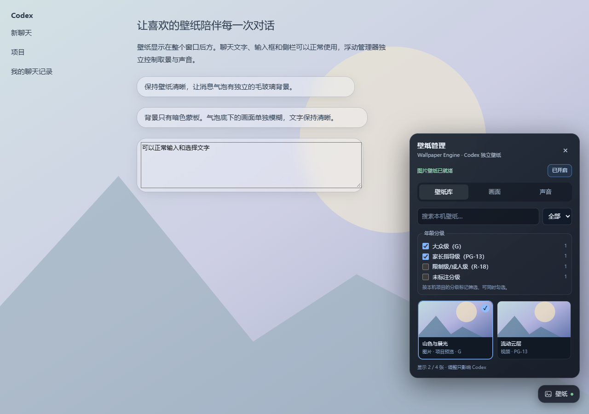

# Codex Wallpaper Manager

给 Windows 版 Codex 添加本机 Wallpaper Engine 视频、图片壁纸，以及透明聊天气泡、输入框和文件预览面板。

本项目只包含壁纸管理功能。它通过本机调试连接加载可撤销的界面样式，不修改 Codex 安装文件，是非官方、实验性的扩展。Codex 更新后可能需要适配。



## 让 Codex 帮你安装

将本仓库网页链接发给 Windows 本地运行的 Codex，并附上：

> 请阅读这个仓库的 README.md 和 INSTALL_FOR_CODEX.md，为我安装 Codex Wallpaper Manager。只安装壁纸功能。检查运行条件，执行安装脚本并验证结果；保留现有 Codex 配置和快捷方式，不要关闭我当前的会话。完成后告诉我如何从 Codex Wallpaper 入口启动。

Codex 需要具备本机文件和终端权限才能执行安装。只发送链接给没有本机执行环境的网页聊天，不能自动完成电脑上的安装。

## 使用条件

| 条件 | 说明 |
| --- | --- |
| 系统 | Windows 10 / 11；当前主要在 Windows 11 验证 |
| Codex | 已安装 Windows 桌面版；已验证构建为 26.1016.6573.0，其他版本需自行检查兼容性 |
| Node.js | 22 或更新；脚本会优先检测 PATH，再检测 Codex 的本地依赖运行时 |
| PowerShell | Windows PowerShell 5.1；视频转码使用 Windows 媒体组件 |
| 壁纸素材 | 已安装 Wallpaper Engine，且本机已下载至少一个支持的壁纸项目 |
| 启动入口 | 首次安装后完全退出 Codex，再用安装器创建的 `Codex Wallpaper` 入口打开 |
| 本机连接 | 默认使用 `127.0.0.1:9222`；端口被其他应用占用时需修改端口 |

**运行时不需要让 Wallpaper Engine 或 Steam 保持后台运行。** 本项目直接读取已下载的本地素材，不同步或控制桌面壁纸。更新、订阅或下载新的创意工坊项目仍由 Wallpaper Engine / Steam 完成。

显示壁纸时，Codex 和本项目的轻量 Node 后台服务需要运行。后台服务由 `Codex Wallpaper` 入口按需启动；不创建 Windows 开机任务。关闭 Codex 一段时间后服务会退出。

普通 Codex 入口没有开启本机调试连接时，无法加载本扩展。安装器不会强制结束正在进行的聊天；先保存工作，再手动完全退出、重新打开一次。

## 功能

- 在 Codex 内独立选择本机壁纸，搜索并按视频、图片筛选。
- 生成并缓存小尺寸缩略图，避免大型预览图占用过多内存。
- 年龄分级多选：G、PG-13、R-18；未标注单列。默认显示 G 和 PG-13，勾选状态自动保存。分级来自项目元数据，不是重新审核内容。
- 整个窗口的界面不透明度、背景暗化、界面模糊。
- 聊天气泡、输入框和右侧文件预览共享透明卡片样式，并可单独调整气泡背景模糊及遮罩。正文不加模糊。
- 调整模式下拖动平移、滚轮缩放；也可使用滑杆、数值输入和复位。每张壁纸分别保存取景。
- 视频静音、音量和暂停；音量只作用于该视频自身音轨。切出 Codex 或最小化时自动暂停。
- 浮动面板和小按钮均可拖动，普通模式不拦截聊天鼠标操作。

## 支持哪些壁纸

| 类型 | 本项目中的表现 |
| --- | --- |
| 视频 | 推荐 MP4 / WebM；能否播放其他容器和编码取决于 Codex 内置解码器 |
| 图片 | JPG、PNG、GIF、WebP、BMP 等本机图片项目 |
| Scene / Web 项目 | 使用项目自带预览图，不运行完整场景、网页脚本、粒子或交互 |
| 音乐 | 只播放视频文件内已有的音轨；不会加载 Scene 项目独立的音乐系统 |

较大的视频可能自动转码到缓存，以降低传输和解码负担。默认上限为 2560×1440、30fps、约 10Mbps，并保留可转码的音轨。源视频不改动；缓存视频可能与原始 4K / 高帧率素材不同。无法解码或超过容量限制时可能使用项目预览图。

## 手动安装

下载 Releases 中的 ZIP 并解压，或者克隆本仓库。在项目目录打开 PowerShell：

```powershell
powershell.exe -NoProfile -ExecutionPolicy Bypass -File .\scripts\install.ps1
```

安装器在用户本地应用数据目录下创建 `CodexWallpaperManager`，写入独立运行时和配置；在 Codex 配置中添加一个带管理标记的 MCP 条目，并安装同名技能。原有配置会备份，其他条目保留。桌面和开始菜单增加 `Codex Wallpaper` 快捷方式，原 Codex 入口保留。

安装后完全退出 Codex，再打开 `Codex Wallpaper`。右上或右下的“壁纸”按钮用于管理壁纸。关闭窗口后如果 Codex 仍留在后台，需要完成一次真正的退出。

自定义参数示例：

```powershell
.\scripts\install.ps1 -Port 9223
.\scripts\install.ps1 -NodePath 'C:\Program Files\nodejs\node.exe'
.\scripts\install.ps1 -CodexExe 'D:\Apps\Codex\ChatGPT.exe'
.\scripts\install.ps1 -ValidateOnly
```

`-ValidateOnly` 只检查条件。`-NoShortcuts` 和 `-NoSkill` 可分别跳过快捷方式和技能安装。安装目录必须是本项目独占的目录。

## 卸载和恢复

从仓库或已安装运行时执行：

```powershell
powershell.exe -NoProfile -ExecutionPolicy Bypass -File .\scripts\uninstall.ps1
```

脚本会停止本项目的服务，移除注入层、受管理的 MCP 配置、技能和快捷方式。默认保留取景配置及备份；加 `-Purge` 可删除整个受管理安装目录。之后从原 Codex 入口打开即可。使用自定义安装路径时，卸载也需要传入相同的 `-InstallRoot`。

## 常见问题

**没有壁纸按钮：** 检查是否用 `Codex Wallpaper` 启动、是否已经完全退出过旧进程、本机是否下载了支持的项目，以及端口是否可用。可以在源码目录运行 `npm run doctor` 查看来源和调试连接状态。

**视频没有声音：** 默认静音；在“声音”页点击开启声音。图片、预览图和没有内嵌音轨的视频不会产生音乐。浏览器首次有声播放可能需要点击。

**壁纸看起来不够清晰：** 将“界面模糊”设为 0，再调整背景暗化和不透明度。Scene/Web 使用的预览图分辨率可能较低；气泡模糊只作用于气泡背景。

**某些壁纸消失：** 检查年龄分级勾选、搜索文字和媒体类型。未标注的项目需要单独勾选；筛选不会替换当前正在显示的壁纸。

**图片和视频是跨聊天共用的吗：** 当前整个 Codex 主窗口共用壁纸；取景按壁纸保存，库筛选按本地 UI 设置保存。没有按聊天分别指定壁纸的功能。

## 本机访问边界

本项目会启用一个仅本机可连接的调试端口。它只连接 URL 严格等于 `app://-/index.html` 的 Codex 主页面；不连接登录页、嵌入浏览器和分离窗口。请在可信本机使用，不要将调试端口转发到公网。

项目本身不发送聊天或壁纸到远端，不需要 API Key；读取本机项目清单、预览图和选中的媒体，并写入配置、缩略图及转码缓存。安装、下载依赖或获取仓库本身仍需要网络。

## 开发和验证

```powershell
npm ci
npx playwright install chromium
npm run verify
```

也可通过 `CODEX_WALLPAPER_TEST_BROWSER` 指定本机 Chromium / Edge 的可执行文件。运行时没有 npm 第三方依赖；Playwright 和 TOML 解析器只用于开发测试。安装测试使用临时目录及空的测试配置，不启动 Codex。

此版本验证了本机素材发现、缩略图缓存、分级筛选、取景与声音设置、透明面板、服务和安装配置。界面结构随 Codex 更新可能变化，出现问题时可卸载恢复。欢迎通过 Issues 提供 Codex 版本、系统版本和可复现步骤，截图前请遮去私人内容。

## 许可与来源

MIT。基于 JonathandNidhog 的 Wallpaper Engine Codex 集成扩展；完整许可和来源见 [LICENSE](LICENSE) 与 [NOTICE.md](NOTICE.md)。
